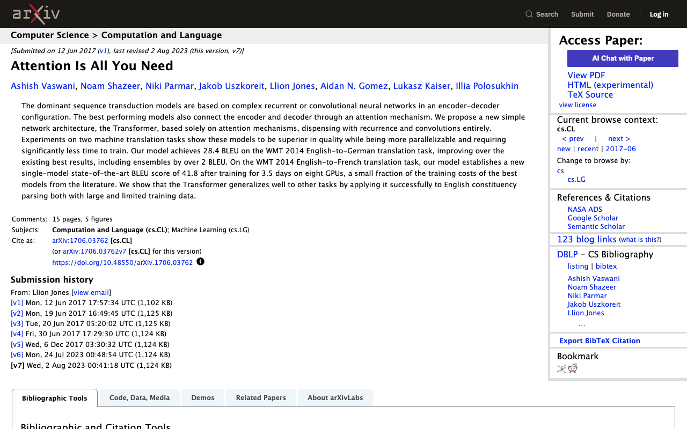
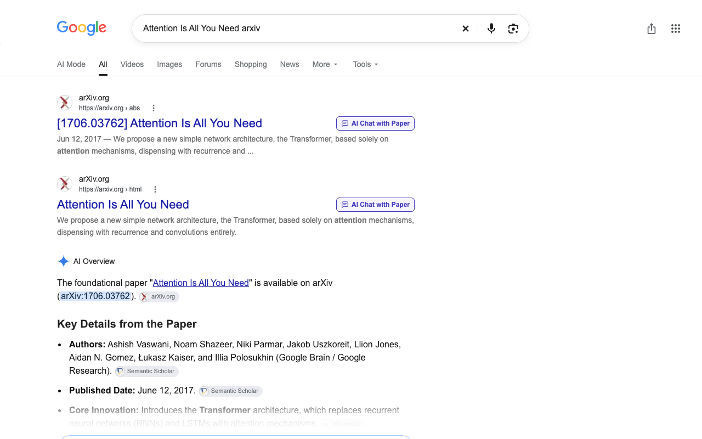
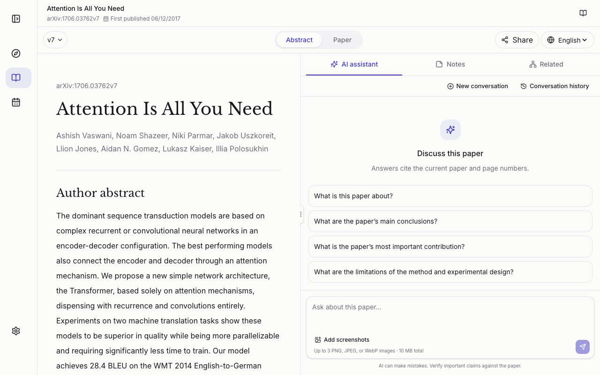

# GradWiser for arXiv

[English](README.md) · **简体中文**

**找到一篇 arXiv 论文？一键在 GradWiser 中打开。**

GradWiser 是面向研究者的论文阅读、批注与论文 AI 对话工作区。这个轻量级 Chrome
扩展会在 arXiv 摘要页及受支持的 Google 论文搜索结果旁添加 **“与论文 AI 对话”**
入口，让你不用再复制、粘贴论文地址。

点击入口后，会在**新标签页打开这篇论文的公共摘要页**，查看摘要无需登录。
PDF 阅读、AI 问答及私人操作的登录验证由 [GradWiser 主站](https://gradwiser.com/zh)
负责，而不是由扩展执行。点击入口**不会自动发送 AI 请求，也不会自动收藏论文到私人资料库**。

> **当前版本：0.1.0。** 请按下方步骤在本地加载。
> Google 仅部分支持：某些匿名／无痕搜索结果使用无法识别的不透明跳转链接。
> 详见下方“支持范围与已知限制”。

## 认识 GradWiser：从论文到研究想法

**发现值得读的论文，理解其中的细节，把阅读积累变成自己的研究。**
[GradWiser](https://gradwiser.com/zh) 将这些步骤放在同一个工作区，
面向研究生、博士生及研究人员，尤其适合关注 AI 与计算机科学的读者。

| 主站主要能力 | 可以帮你做什么 |
| --- | --- |
| **发现论文与研究代码** | 浏览 arXiv 新论文、Hugging Face Daily Papers，以及 GitHub Trending 中的研究代码仓库。 |
| **双语论文阅读** | 对照原文与译文阅读，跨过语言障碍；原文阅读与双语翻译免费开放，无需注册。 |
| **围绕论文的 AI 对话** | 追问论文贡献、概念、公式与方法，通过页码引用回到原文核对解释。 |
| **私人笔记与批注** | 高亮关键段落，记录问题和想法；笔记与上传文档保持私密，并支持免费导出。 |
| **探索相关论文** | 围绕研究主题发现相关工作，梳理概念与方法之间的联系，建立文献阅读路径。 |
| **会议雷达** | 查找 AI／CS 学术会议与投稿截止日期，为下一篇论文安排投稿计划。 |

你可以这样使用它：**发现论文 → 阅读与追问 → 批注关键内容 → 连接相关研究 → 形成自己的想法**。
这个扩展是进入上述工作流的快捷入口，而不是主站功能的替代品。
保存笔记等私人操作需要登录；AI 解释和翻译应结合论文原文核对。

**[访问 GradWiser](https://gradwiser.com/zh)** ·
[体验一篇论文](https://gradwiser.com/zh/abs/1706.03762v7) ·
[查看会议与投稿截止日期](https://gradwiser.com/zh/conferences)

不安装扩展也能体验：在主站首页粘贴 arXiv 链接或论文 ID，点击 **打开论文** 即可。

## 这个扩展能做什么？

- **arXiv 摘要页：** 在 **Access Paper** 列表首位添加入口。
- **Google 搜索页：** 在识别出的 arXiv 结果标题旁添加紧凑的对话入口；窄屏时移到标题下方。
- **保留论文版本：** `1706.03762v7` 会打开明确的 `v7`；无版本链接保持无版本，由主站解析。
- **支持旧版 arXiv ID：** 例如 `hep-th/9901001v2`。
- **跟随浏览器语言：** 浏览器首选语言为 `zh`／`zh-*` 时使用中文，其余使用英文；
  不根据搜索语言判断。
- **保留原生链接操作：** 支持键盘访问、中键打开和复制链接地址，不替换原网站的链接。

## 看看实际效果

以下截图展示英文界面；入口文字与目标页面语言会跟随浏览器首选语言。

### 1. 从 arXiv 论文出发

**AI Chat with Paper** 入口位于 **Access Paper** 列表首位，
与 arXiv 原有的 PDF、HTML 链接并列，不替换原站操作。



### 2. 从 Google 搜索打开论文

可识别的 arXiv 结果会在标题旁显示紧凑入口。图中为受支持的布局，
不代表支持不透明的 `/goto` 跳转链接。



### 3. 进入 GradWiser，继续阅读与对话

点击后打开公共摘要页，主站 AI 助手位于一旁。你可以先阅读摘要，
再决定是否提问，或查看笔记与相关论文。
图中展示的是对话起始界面，并非已经生成的回答；扩展不会自动发送问题。



**[在 GradWiser 中体验这篇论文](https://gradwiser.com/zh/abs/1706.03762v7)**

## 如何安装？

本地加载扩展**不需要构建，不需要安装 Node.js 或依赖**。

1. 在 GitHub 仓库点击 **Code → Download ZIP**，下载后解压。也可以克隆仓库：

   ```sh
   git clone https://github.com/yinzm/gradwiser-extension.git
   ```

2. 在 Chrome 地址栏打开 `chrome://extensions`。
3. 开启右上角的 **开发者模式**。
4. 点击 **加载已解压的扩展程序**（部分版本称“加载未打包的扩展程序”），
   选择解压／克隆后**包含 `manifest.json` 的文件夹**，不要选择 ZIP 文件或上一级目录。
5. 打开受支持的页面；若页面已经打开，请刷新。

更新文件后，需要在扩展卡片上点击 **重新加载**，再刷新来源页面。
安装后请保留该文件夹，Chrome 会直接读取其中的文件。

## 如何使用？

### 从 arXiv 打开

1. 打开论文摘要页，例如
   [Attention Is All You Need，v7](https://arxiv.org/abs/1706.03762v7)。
2. 找到 **Access Paper**，点击 **与论文 AI 对话**
   （英文浏览器显示 **AI Chat with Paper**）。
3. 新标签页会打开同一篇论文的 GradWiser 摘要，可继续阅读或使用主站功能。

### 从 Google 搜索打开

1. 在 `https://www.google.com/search` 搜索论文，例如：
   `site:arxiv.org attention is all you need`。
2. 点击可识别的 arXiv 结果标题旁的对话入口。
3. 若没有入口，该结果可能使用了不受支持的跳转方式或布局。
   可以先打开论文的 arXiv 摘要页，再使用那里的入口。

### 语言与目标地址

| 浏览器首选语言 | 入口文字 | 目标地址 |
| --- | --- | --- |
| `zh`、`zh-CN`、`zh-TW` 等 | 与论文 AI 对话 | `https://gradwiser.com/zh/abs/<id>` |
| 其他语言或无法取得语言偏好 | AI Chat with Paper | `https://gradwiser.com/abs/<id>` |

例如，中文浏览器从上述版本化示例打开的地址是：
`https://gradwiser.com/zh/abs/1706.03762v7`。
扩展没有独立的语言设置；更改浏览器语言后，请刷新来源页面。

## 支持范围与已知限制

| 页面或链接类型 | 支持情况 |
| --- | --- |
| `arxiv.org`、`www.arxiv.org` 的 HTTPS 摘要页 | 添加入口 |
| `www.google.com/search` 中的普通 arXiv 搜索结果 | 仅支持可识别链接及安全的标题布局 |
| Google 结果中的 arXiv `abs`、`pdf`、`html` 链接 | 仅解析论文身份，包括 `export.arxiv.org` 链接 |
| arXiv PDF／HTML 页面、Chrome PDF 查看器 | 不注入入口 |
| 其他 Google 域名、搜索引擎或论文来源 | 暂不支持 |

扩展在本地解析直接来源链接及合法的 Google `/url` 跳转。
部分 Google 结果，包括验收中观察到的匿名布局，使用 `/goto?url=<不透明令牌>`。
**0.1.0 不会为这些结果添加入口。** 扩展不会请求跳转地址、解码令牌，
也不会根据论文标题或截断的显示地址猜测论文身份。
未知且无法安全布局的标题容器也会被跳过，而不是强行重排。

无痕模式还需要在 Chrome 扩展详情中开启 **允许在无痕模式下运行**；
开启后也不会消除上述 Google 跳转限制。
arXiv 匿名摘要链路已通过用户操作、截图核对验证；观察到的 Google 匿名链路尚未通过验收。
具体证据和待验收项见 [CHANGELOG.md](CHANGELOG.md)。

## 隐私与安全

- 用户点击前，扩展**不会主动发起网络请求**；只处理识别论文和放置入口所需的链接与 DOM。
- 不读取账户或 Cookie，不持久化存储数据，不添加遥测、后台服务、API 密钥或运行时依赖；
  不收集周围正文或 Google 搜索词。
- 目标地址固定为 GradWiser HTTPS 站点，论文身份经过校验，不附加来源或追踪参数；
  新标签页使用 `noopener noreferrer` 隔离。
- 点击后，浏览器会正常加载 GradWiser。主站的网络请求与登录验证属于网站行为，
  与扩展点击前的行为不同。

内容脚本需要访问受支持的来源页面才能添加链接；Chrome 可能将其描述为
“读取和更改网站数据”的权限。安全边界及私密漏洞报告方式见 [SECURITY.md](SECURITY.md)。
请勿在公开 Issue 中发布凭证、会话数据或私人内容。

## 开发与贡献

扩展使用原生 JavaScript 与 Chrome Manifest V3。
开发测试需要 **Node.js 22+ 和 pnpm**；仅安装、使用扩展则不需要。

```sh
pnpm install --frozen-lockfile
pnpm check
pnpm test
```

| 文件 | 职责 |
| --- | --- |
| `manifest.json` | 页面匹配与资源加载 |
| `src/paper-link.js` | URL 校验、arXiv 身份、语言与目标地址 |
| `src/content.js` | 页面注入、布局对齐及动态生命周期 |
| `src/content.css` | arXiv 入口与局部 Google 网格样式 |
| `tests/` | Node／jsdom 回归测试 |

Google 入口自身的样式位于 Shadow DOM 中。测试覆盖 URL／语言约定、manifest 资源及 DOM
生命周期；jsdom 只用于开发，不随扩展发布。自动化测试不能替代真实浏览器验收，
详见 [公共入口约定](docs/first-release.md)。

反馈问题时，请提供浏览器／扩展版本、复现步骤，以及是否发生在无痕模式。
仅提供必要、已脱敏的信息，不附带个人信息、搜索历史或不透明跳转令牌。
不要向贡献中加入凭证、用户数据、QA 产物或主站私有代码。
商店发布包只应包含 manifest、其引用的运行文件及声明的图标，不要压缩整个开发目录。

## 仓库边界与许可证

**本仓库仅包含浏览器扩展；GradWiser 主站是独立的闭源服务。**
主站源码、私人 API 和凭证不包含在本仓库中，开发、测试扩展也不需要它们。
公开此仓库不代表公开主站源码，也不授予主站代码的许可证。

扩展尚未选定明确的许可证。在添加许可证前，请勿假定已获得某种开源许可证下的
修改或再分发授权。`package.json` 中的 `private: true` 仅用于防止误发布到 npm，
不控制 GitHub 仓库是否公开。
